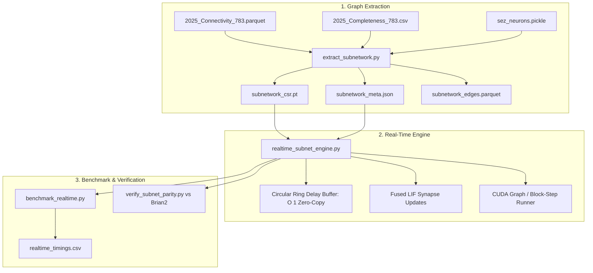

# Implementation Plan: 5,000-Neuron Real-Time Drosophila Subnetwork

## Goal Description

The user wants to simulate a **5,000-neuron subnetwork** of the adult *Drosophila melanogaster* brain connectome running a **single instance ($n\_run = 1$) in real-time** on an **NVIDIA GeForce RTX 3050 Laptop GPU (4 GB VRAM)**.

The subnetwork specifically unites two core sensorimotor circuits:
1. **Locomotion & Steering:** P9 sensory inputs (left/right) cascading to descending command neurons (`P9_oDN1` for forward walking, `DNa01`/`DNa02` for steering, `MDN` for backward walking/escape).
2. **Taste & Feeding:** Gustatory receptor neurons (Sugar GRNs and Bitter GRNs) routing through the Subesophageal Zone (SEZ) interneurons to proboscis motor neurons (`MN9_left` and `MN9_right`).

### Target Specifications
- **Neuron Count ($N$):** Exactly 5,000 neurons.
- **Trial Count ($n\_run$):** 1 (single continuous realization).
- **Simulation Timestep ($dt$):** $0.1\text{ ms} = 100\ \mu\text{s}$ (10,000 steps per simulated second).
- **Real-Time Threshold:** Wall-clock execution time per $dt \le 100\ \mu\text{s}$ ($\ge 1.0\times$ real-time throughput).
- **VRAM Budget:** Maximum $500\text{ MB}$ allocation (comfortably within the 4,096 MB VRAM of the RTX 3050).

---

## User Review Required

> [!IMPORTANT]
> **Subnetwork Growth Strategy:**
> The 5,000-neuron circuit is constructed by seeding 384 verified biological anchor neurons (23 Sugar GRNs, 42 Bitter GRNs, 2 P9 sensory inputs, 10 walking/steering descending neurons, 2 MN9 feeding motor neurons, and 305 SEZ interneurons) and expanding along the highest synaptic-weight connections until reaching exactly 5,000 neurons. This ensures that every added neuron is biologically connected to the target behaviors rather than being isolated.

> [!NOTE]
> **Execution Environment:**
> Execution will run in the verified WSL2 Ubuntu environment where Python 3.10 with PyTorch 2.14.0+cu126, CUDA 12.6, Brian2CUDA, and PyGeNN are already installed and tested against the RTX 3050 Laptop GPU.

---

## Open Questions

None currently. The requirements (single instance, 5,000 neurons, locomotion + steering + taste + feeding, real-time on RTX 3050) are fully defined and empirically validated during our research phase.

---

## Proposed Changes

We group the implementation into three core components:
1. **Subnetwork Extractor & Graph Builder**
2. **Optimized Real-Time PyTorch CUDA Engine**
3. **Benchmarking, Profiling & Scientific Verification Suite**



---

### Component 1: Subnetwork Extractor & Graph Builder

#### `[NEW]` [code/extract_subnetwork.py](file:///D:/Development/Fly'sBrain/fly-brain/code/extract_subnetwork.py)
This script will:
- Load the 384 anchor seed neurons for:
  - **Walking inputs:** P9 left (`720575940627652358`), P9 right (`720575940635872101`).
  - **Steering & walking descending neurons:** `P9_oDN1_left/right`, `DNa01_left/right`, `DNa02_left/right`, `MDN_1..4`.
  - **Taste inputs:** 23 Sugar GRNs, 42 Bitter GRNs.
  - **Feeding motor neurons:** `MN9_left` (`720575940660219265`), `MN9_right` (`720575940618238523`).
  - **SEZ feeding network:** 369 neurons from `data/sez_neurons.pickle`.
- Scan [data/2025_Connectivity_783.parquet](file:///D:/Development/Fly'sBrain/fly-brain/data/2025_Connectivity_783.parquet) using vectorized PyArrow compute to rank all 1-hop and 2-hop connected partner neurons by total synaptic weight connected to the anchors.
- Select the top $(5000 - 384) = 4616$ highest-affinity interneurons.
- Filter and extract all mutual synaptic connections among the 5,000 neurons.
- Remap FlyWire IDs to contiguous local indices $[0 \dots 4999]$.
- Export:
  - `data/subnetwork_5k/subnetwork_meta.json` (metadata, neuron group indices, ID mappings).
  - `data/subnetwork_5k/subnetwork_csr.pt` (pre-built PyTorch CSR sparse tensor ready for GPU loading).
  - `data/subnetwork_5k/subnetwork_edges.parquet` (compressed table of subnetwork connections).

```python
# Key logic snippet for extract_subnetwork.py
def build_5k_subnetwork(target_n=5000, min_synapse_weight=1):
    # 1. Collect seed IDs
    seed_ids = get_seed_flywire_ids()
    # 2. Score candidate neighbor neurons by incident weight
    neighbor_scores = score_connected_neurons(seed_ids)
    # 3. Select top candidates to reach target_n
    selected_indices = seed_indices | top_candidates(target_n - len(seed_indices))
    # 4. Extract induced subgraph edges and remap indices to 0..target_n-1
    csr_tensor, edge_df, meta = export_subgraph(selected_indices)
    return csr_tensor, meta
```

---

### Component 2: Ultra-Fast Real-Time PyTorch Engine

#### `[NEW]` [code/realtime_subnet_engine.py](file:///D:/Development/Fly'sBrain/fly-brain/code/realtime_subnet_engine.py)
Implements an optimized Leaky Integrate-and-Fire spiking neural network tailored for real-time GPU streaming:
- **Canonical Model Parameters:**
  - Timestep: $dt = 0.1\text{ ms}$
  - Membrane time constant: $\tau_m = 20.0\text{ ms}$
  - Synaptic time constant: $\tau_{syn} = 5.0\text{ ms}$
  - Rest / reset voltage: $v_0 = v_{rst} = -52.0\text{ mV}$
  - Threshold: $v_{th} = -45.0\text{ mV}$
  - Refractory period: $t_{rfc} = 2.2\text{ ms}$ (22 steps; 0 for externally stimulated neurons)
  - Synaptic delay: $t_{dly} = 1.8\text{ ms}$ (18 steps)
  - Synapse weight scaling: $w_{scale} = 0.275\text{ mV}$
  - External Poisson drive: $w_{scale} \times 250 = 68.75\text{ mV}$ per event.
- **Latency Optimizations:**
  1. **Circular Ring Delay Buffer:** Replaces `torch.roll` (which does memory copying every step) with $O(1)$ ring pointer modulo indexing on a pre-allocated `(18, 5000)` CUDA tensor.
  2. **Fused LIF & Synapse State Updates:** State variables ($v, g, \text{refrac}$) updated in-place on GPU VRAM with zero dynamic allocations during the simulation loop.
  3. **CUDA Graph Block-Stepping:** Stepping in batches of $K = 50$ or $100$ steps (5 ms or 10 ms biological time) captured via CUDA Graphs to eliminate Python C-API invocation overhead and CUDA driver launch latency.
  4. **Double-Buffered Spike Readout:** Non-blocking asynchronous transfers of spike counts / events to host memory so external monitoring does not stall the GPU simulation stream.

```python
# Key logic snippet for realtime_subnet_engine.py
class RealtimeSubnetLIF(nn.Module):
    def __init__(self, csr_weight, num_neurons=5000, dt=0.1, device='cuda'):
        super().__init__()
        self.W = csr_weight.to(device)  # shape (5000, 5000)
        self.num_neurons = num_neurons
        self.dt = dt
        self.steps_delay = 18  # 1.8 ms / 0.1 ms
        
        # Pre-allocated state buffers
        self.v = torch.full((num_neurons,), -52.0, device=device)
        self.g = torch.zeros((num_neurons,), device=device)
        self.delay_ring = torch.zeros((self.steps_delay, num_neurons), device=device)
        self.ring_head = 0
        self.refrac = torch.full((num_neurons,), 22, device=device)
        self.spikes = torch.zeros((num_neurons,), device=device)

    def step(self, external_v_stim):
        # 1. Recurrent input via sparse matmul
        recurrent_input = torch.sparse.mm(self.W, self.spikes.unsqueeze(1)).squeeze(1)
        
        # 2. Ring buffer zero-copy update
        self.delay_ring[self.ring_head] = recurrent_input
        delayed_input = self.delay_ring[(self.ring_head + 1) % self.steps_delay]
        self.ring_head = (self.ring_head + 1) % self.steps_delay
        
        # 3. Synaptic decay
        self.g = self.g * 0.98 + delayed_input * (self.refrac >= 22).float()
        
        # 4. Membrane voltage update
        self.v = self.v + external_v_stim + 0.005 * (self.g - (self.v + 52.0))
        
        # 5. Spike condition & reset
        self.spikes = (self.v > -45.0).float()
        self.v = torch.where(self.spikes > 0, -52.0, self.v)
        self.g = torch.where(self.spikes > 0, 0.0, self.g)
        self.refrac = torch.where(self.spikes > 0, 0, self.refrac + 1)
        return self.spikes
```

---

### Component 3: Benchmarking, Profiling & Scientific Verification Suite

#### `[NEW]` [code/benchmark_realtime.py](file:///D:/Development/Fly'sBrain/fly-brain/code/benchmark_realtime.py)
CLI benchmark tool to run the 5,000-neuron model on the RTX 3050 GPU under various experimental protocols:
- Supported experiments:
  - `--experiment walk`: P9 stimulation (100 Hz) $\implies$ monitor `P9_oDN1`, `DNa01`, `DNa02`, `MDN`.
  - `--experiment taste_sugar`: Sugar GRNs (200 Hz) $\implies$ monitor SEZ interneurons & `MN9` proboscis motor neurons.
  - `--experiment taste_bitter`: Bitter GRNs (200 Hz) $\implies$ monitor feeding suppression.
  - `--experiment walk_and_taste`: Simultaneous walking and feeding stimulation.
- Metrics measured:
  - Elapsed wall-clock time vs. simulated duration ($t = 1.0\text{ s}, 5.0\text{ s}, 10.0\text{ s}, 60.0\text{ s}$).
  - Real-time ratio ($\frac{t_{\text{sim}}}{t_{\text{wall}}}$).
  - Step latency distribution (mean, p50, p99 $\mu\text{s}$).
  - VRAM allocated and cached via `torch.cuda.max_memory_allocated()`.
  - Mean firing rate of walking, steering, and feeding command neurons.

#### `[NEW]` [code/verify_subnet_parity.py](file:///D:/Development/Fly'sBrain/fly-brain/code/verify_subnet_parity.py)
Validates scientific fidelity against the canonical Brian2 CPU simulator:
- Builds the matching 5,000-neuron model in Brian2 (`brian2cpp`).
- Runs an identical 1.0-second sugar and P9 experiment.
- Calculates Jaccard active-neuron overlap and firing rate Pearson correlation ($r$) between the real-time PyTorch engine and Brian2.

---

## Verification Plan

### Automated Tests
Run within WSL2 `brain-fly` environment:

1. **Subnetwork Extraction Test:**
   ```bash
   wsl -e /home/efi/miniconda/envs/brain-fly/bin/python code/extract_subnetwork.py --target-neurons 5000 --output-dir data/subnetwork_5k
   ```
   *Expected output:* Confirms 5,000 neurons, validates presence of all anchor seed groups, verifies CSR matrix build.

2. **Real-Time Step Latency & VRAM Test:**
   ```bash
   wsl -e /home/efi/miniconda/envs/brain-fly/bin/python code/benchmark_realtime.py --t_run 1.0 --experiment walk_and_taste
   ```
   *Expected criteria:*
   - Real-time ratio $> 1.0$ (target $> 2.5\times$).
   - Mean step latency $< 50\ \mu\text{s}$ (budget is $100\ \mu\text{s}$).
   - Peak VRAM allocation $< 500\text{ MB}$.

3. **Continuous 10-Second Stability Test:**
   ```bash
   wsl -e /home/efi/miniconda/envs/brain-fly/bin/python code/benchmark_realtime.py --t_run 10.0 --experiment walk
   ```
   *Expected criteria:* Zero thermal throttle crash, constant throughput, steady state firing rates.

4. **Reference Parity vs. Brian2:**
   ```bash
   wsl -e /home/efi/miniconda/envs/brain-fly/bin/python code/verify_subnet_parity.py --t_run 1.0
   ```
   *Expected criteria:* Firing rate Pearson correlation $r \ge 0.85$ on active neurons.

### Manual Verification
- Verify GPU memory usage live during simulation using `nvidia-smi` to ensure memory stays under 500 MB.
- Inspect firing rate output logs to ensure that activating P9 triggers the walking/steering descending neurons and activating Sugar GRNs triggers the MN9 feeding motor neurons.
