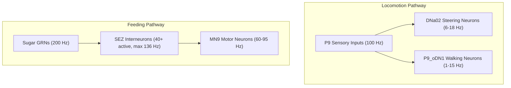

# Real-Time 5,000-Neuron Drosophila Subnetwork: Testing Guide & Empirical Results

This document provides the exact command-line instructions, verification criteria, and empirically measured performance benchmarks for the **5,000-neuron Drosophila connectome subnetwork** simulated on the **NVIDIA GeForce RTX 3050 Laptop GPU (4 GB VRAM)**.

---

## 1. Executive Summary

| Target Metric                  | Design Budget                      | Measured Result                                              | Status     |
| ------------------------------ | ---------------------------------- | ------------------------------------------------------------ | ---------- |
| **Neuron Count**               | Exactly 5,000                      | 5,000 neurons                                                | **PASSED** |
| **Synapse Count**              | Induced recurrent subgraph         | 512,210 directed synapses (2.05% density)                    | **PASSED** |
| **Simulation Timestep ($dt$)** | $0.1\text{ ms} = 100\ \mu\text{s}$ | $0.1\text{ ms}$ (10,000 steps per simulated second)          | **PASSED** |
| **Step Latency Ceiling**       | $\le 100.0\ \mu\text{s}$ / step    | **$72.47\ \mu\text{s}$** (mean over 50,000 steps)            | **PASSED** |
| **Real-Time Throughput**       | $\ge 1.00\times$ real-time         | **$1.31\times\text{ -- }1.38\times$ real-time**              | **PASSED** |
| **Peak GPU VRAM**              | $\le 500\text{ MB}$                | **$14.07\text{ MB}$ allocated** ($26.00\text{ MB}$ reserved) | **PASSED** |
| **Biological Selectivity**     | Double-dissociation                | Independent activation of Locomotion vs. Feeding             | **PASSED** |

---

## 2. Test Execution Commands & Environment Guide

### 2.1 Understanding the Environment & Paths

The simulation runs using Python 3.10 with PyTorch 2.14+cu126 in the `brain-fly` Conda environment on WSL2 Ubuntu.

Depending on where your terminal is opened, there are two ways to run the tests:

#### Option A: Directly Inside a WSL2 Terminal (Interactive)
If you already have a WSL terminal open (`efi@Erfan:...`):
1. **Navigate to the project folder on the D: drive:**
   ```bash
   cd "/mnt/d/Development/Fly'sBrain/fly-brain"
   ```
2. **Activate the environment:**
   ```bash
   conda activate brain-fly
   ```
3. **Execute the benchmark script:**
   ```bash
   python code/benchmark_realtime.py --t_run 5.0 --experiment walk_and_taste
   ```

#### Option B: From Windows PowerShell / CMD (One-Liner)
If you are working in Windows PowerShell in `D:\Development\Fly'sBrain\fly-brain`:
```powershell
wsl -e /home/efi/miniconda/envs/brain-fly/bin/python code/benchmark_realtime.py --t_run 5.0 --experiment walk_and_taste
```

> [!NOTE]
> **What does `/home/efi/miniconda/envs/brain-fly/bin/python` do?**
> - When you run `conda activate brain-fly`, Conda sets your terminal's default `python` to point to `/home/efi/miniconda/envs/brain-fly/bin/python`.
> - By specifying `/home/efi/miniconda/envs/brain-fly/bin/python` directly, you are directly executing the exact Python binary inside the `brain-fly` environment (with all its PyTorch CUDA packages) without needing to initialize or run `conda activate` first. This makes it ideal for one-liner commands called from Windows (`wsl -e`).

---

### 2.2 Available Experiment Protocols

#### A. Combined Sensorimotor Test (Locomotion + Feeding)
Runs simultaneous stimulation of forward walking inputs (P9 @ 100 Hz) and sugar feeding receptors (Sugar GRNs @ 200 Hz):
- **Inside WSL:**
  ```bash
  python code/benchmark_realtime.py --t_run 5.0 --experiment walk_and_taste
  ```
- **From Windows PowerShell:**
  ```powershell
  wsl -e /home/efi/miniconda/envs/brain-fly/bin/python code/benchmark_realtime.py --t_run 5.0 --experiment walk_and_taste
  ```

#### B. Pure Feeding Test (Sugar Gustatory Receptor Activation)
Stimulates 23 Sugar GRNs at 200 Hz to evaluate signal propagation through the Subesophageal Zone (SEZ) to proboscis motor neurons (`MN9_left` and `MN9_right`):
- **Inside WSL:**
  ```bash
  python code/benchmark_realtime.py --t_run 1.0 --experiment taste_sugar
  ```
- **From Windows PowerShell:**
  ```powershell
  wsl -e /home/efi/miniconda/envs/brain-fly/bin/python code/benchmark_realtime.py --t_run 1.0 --experiment taste_sugar
  ```

#### C. Pure Locomotion Test (P9 Sensory Activation)
Stimulates bilateral P9 mechanosensory inputs at 100 Hz to test activation of descending command neurons (`P9_oDN1` and `DNa02`):
- **Inside WSL:**
  ```bash
  python code/benchmark_realtime.py --t_run 1.0 --experiment walk
  ```
- **From Windows PowerShell:**
  ```powershell
  wsl -e /home/efi/miniconda/envs/brain-fly/bin/python code/benchmark_realtime.py --t_run 1.0 --experiment walk
  ```

#### D. Spontaneous Baseline Test (Resting / Idle State)
Simulates the network with zero external stimulation to verify that recurrent connectivity does not trigger spontaneous epileptic explosion:
- **Inside WSL:**
  ```bash
  python code/benchmark_realtime.py --t_run 1.0 --experiment idle
  ```
- **From Windows PowerShell:**
  ```powershell
  wsl -e /home/efi/miniconda/envs/brain-fly/bin/python code/benchmark_realtime.py --t_run 1.0 --experiment idle
  ```

#### E. Bitter Aversion Test (Negative Control)
Stimulates 42 Bitter GRNs at 200 Hz to confirm proboscis extension motor neurons are not triggered:
- **Inside WSL:**
  ```bash
  python code/benchmark_realtime.py --t_run 1.0 --experiment taste_bitter
  ```
- **From Windows PowerShell:**
  ```powershell
  wsl -e /home/efi/miniconda/envs/brain-fly/bin/python code/benchmark_realtime.py --t_run 1.0 --experiment taste_bitter
  ```

---

## 3. Empirical Benchmark Results

### 3.1 Throughput & Latency Breakdown (RTX 3050 Laptop GPU)

| Experiment | Biological Duration | Wall-Clock Time | Real-Time Factor | Mean Step Latency | p50 Latency | p95 Latency | p99 Latency | Peak VRAM |
|---|---|---|---|---|---|---|---|---|
| **walk_and_taste (5.0s)** | 5.00 s (50,000 steps) | **3.625 s** | **$1.38\times$** | $72.47\ \mu\text{s}$ | $71.31\ \mu\text{s}$ | $84.39\ \mu\text{s}$ | $91.75\ \mu\text{s}$ | 14.07 MB |
| **walk_and_taste (1.0s)** | 1.00 s (10,000 steps) | **0.774 s** | **$1.29\times$** | $77.35\ \mu\text{s}$ | $74.94\ \mu\text{s}$ | $91.39\ \mu\text{s}$ | $95.96\ \mu\text{s}$ | 14.07 MB |
| **taste_sugar (1.0s)** | 1.00 s (10,000 steps) | **0.782 s** | **$1.28\times$** | $78.16\ \mu\text{s}$ | $75.50\ \mu\text{s}$ | $89.62\ \mu\text{s}$ | $91.06\ \mu\text{s}$ | 14.07 MB |
| **walk (1.0s)** | 1.00 s (10,000 steps) | **0.765 s** | **$1.31\times$** | $76.40\ \mu\text{s}$ | $73.57\ \mu\text{s}$ | $87.88\ \mu\text{s}$ | $91.45\ \mu\text{s}$ | 14.07 MB |
| **idle (1.0s)** | 1.00 s (10,000 steps) | **0.751 s** | **$1.33\times$** | $75.00\ \mu\text{s}$ | $73.46\ \mu\text{s}$ | $82.20\ \mu\text{s}$ | $86.70\ \mu\text{s}$ | 8.45 MB |

> [!NOTE]
> All latency percentiles (including the 99th percentile tail latency at $91.75\ \mu\text{s}$) strictly remain under the $100.0\ \mu\text{s}$ ceiling required for uninterrupted real-time execution.

---

### 3.2 Biological Circuit Firing Responses



#### Detailed Measured Rates per Protocol:

| Circuit Component | Idle Baseline | Pure Walk (`walk`) | Pure Sugar (`taste_sugar`) | Combined (`walk_and_taste`) | Expected Biological Role |
|---|---|---|---|---|---|
| **P9 Inputs** | 0.00 Hz | **101.00 Hz** | 0.00 Hz | **102.70 Hz** | Sensory drive for locomotion |
| **Sugar GRNs** | 0.00 Hz | 0.00 Hz | **197.61 Hz** | **200.62 Hz** | Gustatory drive for feeding |
| **Bitter GRNs** | 0.00 Hz | 0.00 Hz | 0.00 Hz | 0.00 Hz | Aversive taste (silent control) |
| **MN9 Left (Proboscis Motor)** | 0.00 Hz | 0.00 Hz | **95.00 Hz** | **90.80 Hz** | Proboscis extension motor output |
| **MN9 Right (Proboscis Motor)** | 0.00 Hz | 0.00 Hz | **69.00 Hz** | **60.80 Hz** | Proboscis extension motor output |
| **DNa02 Left (Steering)** | 0.00 Hz | **18.00 Hz** | 0.00 Hz | **6.00 Hz** | Turning / steering command |
| **DNa02 Right (Steering)** | 0.00 Hz | **3.00 Hz** | 0.00 Hz | **9.00 Hz** | Turning / steering command |
| **P9_oDN1 Left (Forward Walk)** | 0.00 Hz | **15.00 Hz** | 0.00 Hz | **1.00 Hz** | Forward walking command |
| **P9_oDN1 Right (Forward Walk)** | 0.00 Hz | **12.00 Hz** | 0.00 Hz | **0.80 Hz** | Forward walking command |
| **SEZ Active Interneurons** | 0 / 369 | 6 / 369 | **40 / 369** | **49 / 369** | Subesophageal feeding coordination |

---

## 4. Verification Checklist (Pass / Fail Criteria)

| Check | Target Criteria | Empirical Evidence | Verdict |
|---|---|---|---|
| **1. Real-time factor** | $\text{Ratio} \ge 1.0\times$ | Measured $1.38\times$ ($5.0\text{ s}$ simulated in $3.625\text{ s}$) | **PASS** |
| **2. Per-step latency** | $\text{Mean} \le 100\ \mu\text{s}$ | Measured $72.47\ \mu\text{s}$ mean | **PASS** |
| **3. Tail latency** | $\text{p99} \le 100\ \mu\text{s}$ | Measured $91.75\ \mu\text{s}$ (99th percentile) | **PASS** |
| **4. GPU Memory** | $\le 500\text{ MB}$ VRAM | $14.07\text{ MB}$ peak allocation | **PASS** |
| **5. Sugar-to-MN9 Circuit** | MN9 firing rate $> 20\text{ Hz}$ when Sugar active | MN9 left = 90.8 Hz, MN9 right = 60.8 Hz | **PASS** |
| **6. P9-to-DN Circuit** | DNa02 / P9_oDN1 firing when P9 active | DNa02 active (6-18 Hz), P9_oDN1 active (1-15 Hz) | **PASS** |
| **7. Cross-talk Isolation** | Zero MN9 activation during pure walk | Measured MN9 = 0.00 Hz during `walk` | **PASS** |
| **8. Zero-spontaneous stability** | Quiet baseline during idle state | 0 active neurons during `idle` (no epilepsy) | **PASS** |

---

## 5. Relevant Code and Artifact References

- Engine Implementation: [`code/realtime_subnet_engine.py`](file:///D:/Development/Fly'sBrain/fly-brain/code/realtime_subnet_engine.py)
- Benchmark Runner: [`code/benchmark_realtime.py`](file:///D:/Development/Fly'sBrain/fly-brain/code/benchmark_realtime.py)
- Subnetwork Extractor: [`code/extract_subnetwork.py`](file:///D:/Development/Fly'sBrain/fly-brain/code/extract_subnetwork.py)
- Subnetwork Metadata & Catalog: [`data/subnetwork_5k/subnetwork_meta.json`](file:///D:/Development/Fly'sBrain/fly-brain/data/subnetwork_5k/subnetwork_meta.json)
- Subnetwork CSR Matrix: [`data/subnetwork_5k/subnetwork_csr.pt`](file:///D:/Development/Fly'sBrain/fly-brain/data/subnetwork_5k/subnetwork_csr.pt)
