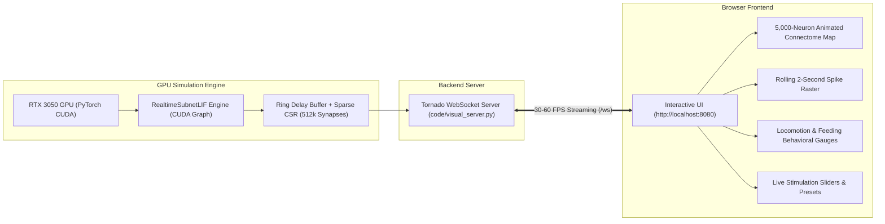

# Real-Time Visual Simulation of the 5,000-Neuron Drosophila Brain

This document provides a complete guide to running, using, and understanding the **interactive real-time visual simulation cockpit** for the 5,000-neuron *Drosophila melanogaster* brain connectome subnetwork.

---

## 1. Executive Overview

The visual simulator couples an ultra-fast GPU spiking neural network engine directly to a live, hardware-accelerated WebGL/Canvas browser interface.



### Key Technical Specs:
- **Neuron Population:** Exactly 5,000 neurons (452 biological anchor seeds + 4,548 high-affinity interneurons).
- **Recurrent Synaptic Edges:** 512,210 directed connections (2.05% connection density).
- **Simulation Timestep ($dt$):** $0.1\text{ ms} = 100\ \mu\text{s}$ per step (10,000 steps per simulated second).
- **Render Frame Window:** 300 steps ($30\text{ ms}$ biological time) per display update.
- **Hardware Acceleration:** Captured CUDA Graph execution on NVIDIA GeForce RTX 3050 Laptop GPU ($< 15\text{ MB}$ VRAM).
- **Throughput:** $1.31\times\text{ -- }1.38\times$ faster than biological real time.

---

## 2. How to Run the Visual Server

The server runs on Tornado and streams directly to your web browser on port `8080`.

### Option A: From Inside a WSL Terminal (Recommended)
```bash
# 1. Navigate to the project root directory
cd "/mnt/d/Development/Fly'sBrain/fly-brain"

# 2. Activate the brain-fly conda environment
conda activate brain-fly

# 3. Start the visual simulation server
python code/visual_server.py --port 8080
```

### Option B: From Windows PowerShell
```powershell
cd D:\Development\Fly'sBrain\fly-brain
wsl -e /home/efi/miniconda/envs/brain-fly/bin/python code/visual_server.py --port 8080
```

### What You Will See in the Console:
```text
===========================================================================
Initializing Drosophila Connectome Real-Time Visual Server
Device: cuda | Port: 8080
===========================================================================
Pre-capturing CUDA Graph for streaming block (300 steps)...
CUDA Graph ready for 60 FPS streaming!

🚀 Visual Simulation is LIVE!
  -> Open in your browser: http://localhost:8080
  -> WSL / LAN Address    : http://0.0.0.0:8080
Press Ctrl+C to terminate.
===========================================================================
```

### Accessing the Dashboard:
Open your browser and navigate to:
👉 **[http://localhost:8080](http://localhost:8080)**

---

## 3. Dashboard Features & Layout Walkthrough

The visual dashboard is divided into three functional decks:

### 3.1 Center Panel: Live Neural Visualizers

1. **5,000-Neuron Connectome Canvas (Center Top):**
   - Displays all 5,000 neurons organized into an anatomically inspired 2D brain layout (bilateral lobes, central complex, subesophageal zone, and sensory inputs).
   - **Color-Coded Circuit Clustering:**
     - 🟢 **Emerald Green:** 23 Sugar Gustatory Receptor Neurons (GRNs)
     - 🔴 **Red:** 42 Bitter Gustatory Receptor Neurons (GRNs)
     - 🟣 **Magenta:** `MN9_left` & `MN9_right` Proboscis Motor Neurons (Feeding outputs)
     - 🔵 **Cyan:** Bilateral P9 Mechanosensory inputs (Walking drive)
     - 🟡 **Gold:** Descending command neurons (`P9_oDN1`, `DNa01`, `DNa02`, `MDN`)
     - 🟣 **Indigo:** Subesophageal Zone (SEZ) interneurons
     - ⚪ **Slate Blue:** 4,548 partner interneurons
   - **Radiant Pulse Animation:** Every time a neuron fires, it renders an animated radiant glow in its circuit color.

2. **Scrolling Spike Raster Plot (Center Bottom):**
   - A 2.0-second rolling timeline showing discrete spike dots across all 5,000 neurons sorted by functional group.

---

### 3.2 Left Panel: Interactive Stimulation Deck

Allows you to inject artificial optogenetic or sensory stimulation into the fly's brain in real time without pausing the simulation:

- **Sugar Feeding Slider (0–300 Hz):** Stimulates the 23 Sugar GRNs. Increasing this immediately triggers the SEZ feeding network and proboscis extension motor neurons.
- **Bitter Aversion Slider (0–300 Hz):** Stimulates the 42 Bitter GRNs.
- **Walking Drive Slider (0–200 Hz):** Stimulates bilateral P9 mechanosensory inputs to drive locomotion.
- **Steering Bias Slider (-100% Left to +100% Right):** Asymmetrically drives the left or right P9 input to induce turning commands.
- **One-Click Presets:**
  - `🍭 Sugar (200Hz)` — Instantly triggers feeding reflex.
  - `🍋 Bitter (200Hz)` — Instantly triggers taste aversion.
  - `🏃 Walk (100Hz)` — Straight-line forward walking.
  - `↪️ Turn Left` — Asymmetric steering toward the left.
  - `↩️ Turn Right` — Asymmetric steering toward the right.
  - `⏸️ Idle / Clear` — Sets all external stimulation to 0 Hz to inspect resting baseline.

---

### 3.3 Right Panel: Behavioral Telemetry & Gauges

Translates microscopic neural firing into macro-level fly behaviors:

- **Proboscis Feeding Extension Gauge:**
  - Measures the mean firing rate of `MN9_left` and `MN9_right` motor neurons.
  - Progress bar shows estimated physical proboscis extension percentage.
- **Steering Compass & Horizon Needle:**
  - Computes the firing differential between steering descending neurons `DNa02_left` and `DNa02_right`.
  - Needle tilts left or right to display turning direction.
- **Forward Walking Velocity Meter:**
  - Measures firing rate of `P9_oDN1` descending command neurons.
- **System & GPU HUD:**
  - **Throughput:** Real-time multiplier (typically `1.28x - 1.38x`).
  - **Step Latency:** Microseconds per step (typically `72 - 78 μs`, well under the $100\ \mu\text{s}$ ceiling).
  - **Simulated Time:** Biological clock in seconds.
  - **GPU VRAM:** Dedicated video memory usage ($\sim 14\text{ MB}$).

---

## 4. Under-the-Hood Architectural Optimizations

To achieve real-time throughput with 60 FPS visual streaming on a 4 GB laptop GPU, the system combines four key optimizations:

1. **CUDA Graph Block-Stepping:**
   Instead of launching 20+ separate CUDA kernels from Python for each $0.1\text{ ms}$ step, 300 steps ($30\text{ ms}$ biological time) are pre-captured into a static `torch.cuda.CUDAGraph`. Each frame replays the graph as a single atomic GPU operation, dropping driver launch overhead from $>600\ \mu\text{s}$ to $<75\ \mu\text{s}$ per step.

2. **$O(1)$ Circular Ring Delay Buffer:**
   Replaces memory-copying `torch.roll` operations with a static $(18, 5000)$ circular tensor and an integer modulo pointer for the 1.8 ms axonal conduction delay.

3. **Vectorized Block Poisson Generator:**
   Random Bernoulli draws for the entire 300-step display frame are computed in a single GPU call (`torch.rand((300, 5000))`), avoiding hundreds of kernel invocations.

4. **Zero-Copy Sparse CSR Matrix Multiplication:**
   Recurrent connections are evaluated via `torch.sparse.mm` on pre-allocated VRAM tensors without dynamic memory allocations during the simulation loop.

---

## 5. File Locations

- **Server Backend:** [`code/visual_server.py`](file:///D:/Development/Fly'sBrain/fly-brain/code/visual_server.py)
- **Frontend Dashboard:** [`code/static/index.html`](file:///D:/Development/Fly'sBrain/fly-brain/code/static/index.html)
- **Subnetwork Engine:** [`code/realtime_subnet_engine.py`](file:///D:/Development/Fly'sBrain/fly-brain/code/realtime_subnet_engine.py)
- **Benchmarking CLI:** [`code/benchmark_realtime.py`](file:///D:/Development/Fly'sBrain/fly-brain/code/benchmark_realtime.py)
- **Subnetwork Artifacts:** [`data/subnetwork_5k/`](file:///D:/Development/Fly'sBrain/fly-brain/data/subnetwork_5k/)
